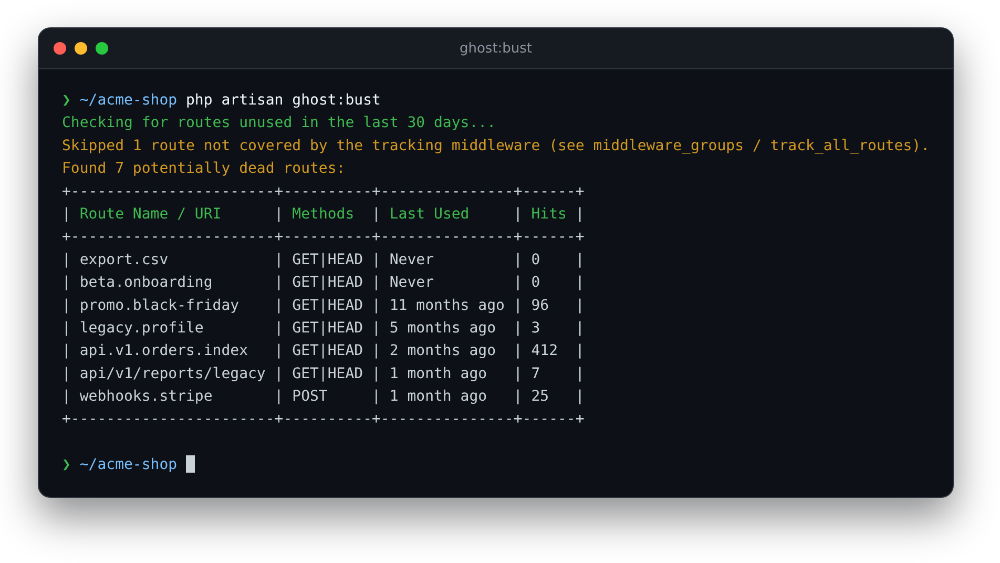
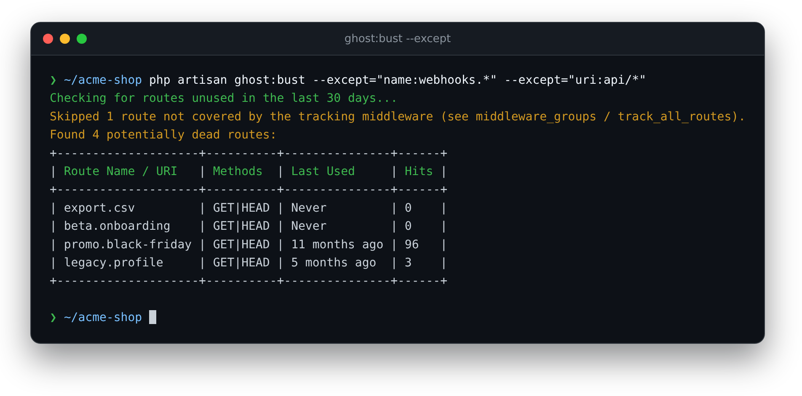
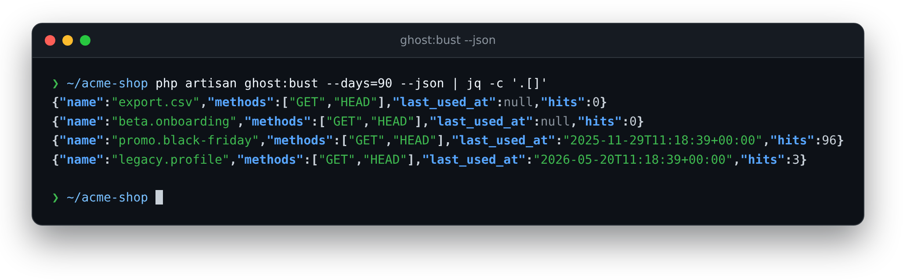
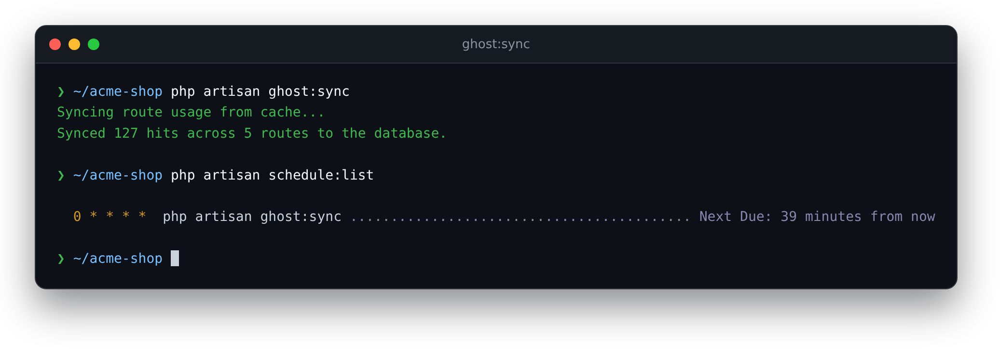

<h1 align="center">👻 Ghost Buster</h1>

<p align="center">
    <strong>Find the routes in your Laravel app that nobody uses any more.</strong><br>
    Ghost Buster quietly records which routes get real traffic, then lists the ones that don't,<br>
    so you can delete dead code with data instead of guesswork.
</p>

<p align="center">
    <a href="https://github.com/Jarryd-W-Hoffman/ghost-buster/actions/workflows/tests.yml"></a>
    
    
    
</p>

<p align="center">
    
</p>

<p align="center">
    <a href="#why-ghost-buster">Why Ghost Buster?</a> ·
    <a href="#features">Features</a> ·
    <a href="#installation">Installation</a> ·
    <a href="#commands">Commands</a> ·
    <a href="#configuration">Configuration</a> ·
    <a href="#what-gets-stored">What gets stored</a> ·
    <a href="#how-its-built">How it's built</a> ·
    <a href="#development">Development</a> ·
    <a href="#license">License</a>
</p>

---

## Why Ghost Buster?

- **Delete with confidence.** Old marketing pages, retired API versions and forgotten webhooks pile up. Ghost Buster shows which routes haven't been hit in weeks, how long ago they were last used, and how much traffic they ever had.
- **Every route, wherever it's defined.** It hooks into the router, so `routes/web.php`, modular route files and package routes are all covered.
- **Out of your users' way.** Hits are recorded after the response has been sent, and busy apps can buffer them in the cache or throttle writes.
- **Nothing personal.** Only the route, the HTTP method, a timestamp and a hit count are stored. Never payloads, headers, IPs or users.

## Features

### 👀 Tracking
- **Automatic:** a middleware is added to your `web` and `api` groups, with no code changes needed. Turn on `track_all_routes` to track every route instead.
- **Successful requests only:** responses with a status of 400 or more aren't counted, so failed or rejected requests don't make a route look used.
- **Per method:** `GET /orders` and `POST /orders` are tracked separately, even when the routes aren't named.
- **Hit counts:** each route keeps a running total, so a route used three times stands out from one used 400 times.

### 🔎 Busting
- **`ghost:bust`** lists every route not used in the last 30 days (or `--days=N`). Routes that have **never** been used come first, then the longest unused.
- **Last used and hits** for every route listed, so you can tell a forgotten page from a quiet but important one.
- **One-off exclusions:** `--except` hides more patterns for a single run, without touching your config.
- **JSON output:** `--json` for scripts, CI checks or `jq`.
- **Honest about gaps:** routes the tracker never runs on are left out of the report, with a warning, instead of always looking dead.

<p align="center">
    
    
</p>

### ⚡ Busy apps
- **Cache driver:** record hits in Redis (or any cache store) instead of the database, and flush them in bulk with `ghost:sync`. When the cache driver is on, the sync is scheduled for you, hourly by default.
- **Write throttle:** with the database driver, `throttle` skips repeat writes for the same route within a window of seconds.
- **One query per hit:** database writes are a single upsert.

<p align="center">
    
</p>

### 🛡️ Ignoring routes
- **Patterns** match route names (`name:telescope*`), URIs (`uri:admin/*`) or both (`horizon*`), with `*` wildcards.
- **Sensible defaults:** Telescope, Horizon, Debugbar, Laravel's local file storage routes and the `/up` health check are ignored out of the box.
- Ignored routes are neither tracked nor reported.

## Installation

### Requirements

- **PHP** 8.3+
- **Laravel** 12 or 13

### Install

```bash
composer require jarryd/ghost-buster
php artisan migrate
```

That's it: tracking starts with the next request. Let it run for a while (a few weeks of real traffic is a good start), then [bust some ghosts](#commands).

To change the defaults, publish the config file:

```bash
php artisan vendor:publish --tag="ghost-buster-config"
```

### Upgrading

New versions may add migrations (for example, the `hits` column). Run `php artisan migrate` after updating.

## Commands

| Command | What it does |
| --- | --- |
| `php artisan ghost:bust` | List routes not used in the last 30 days |
| `php artisan ghost:bust --days=90` | Use a different inactivity window (a whole number, 0 or more) |
| `php artisan ghost:bust --except="name:admin.*"` | Hide more patterns for this run; repeat the option for several |
| `php artisan ghost:bust --json` | Print the ghosts as JSON: `name`, `methods`, `last_used_at` (ISO 8601 or `null`) and `hits` |
| `php artisan ghost:sync` | Flush cached hits to the database (cache driver only; scheduled automatically) |

## Configuration

All options live in `config/ghost-buster.php`:

| Option | Default | What it does |
| --- | --- | --- |
| `driver` | `database` | Where hits go: `database` writes each hit straight away; `cache` buffers them in your cache until `ghost:sync`. Env: `GHOST_BUSTER_DRIVER`. |
| `sync_frequency` | `hourly` | How often the scheduler runs `ghost:sync` with the cache driver. Any scheduler frequency method, such as `everyTenMinutes` or `daily`. |
| `ignore_patterns` | Telescope, Horizon, Debugbar, storage, `up` | Routes to neither track nor report. `name:` matches route names, `uri:` matches URIs (leading `/` optional), no prefix matches both. `*` is a wildcard. |
| `cache_prefix` | `ghost_buster:hit:` | Prefix for cache keys. Change it if several apps share a cache store. |
| `middleware_groups` | `['web', 'api']` | Groups the tracker is added to. Groups your app doesn't define are skipped. |
| `track_all_routes` | `false` | Add the tracker as global middleware instead, so every route is tracked. Env: `GHOST_BUSTER_TRACK_ALL_ROUTES`. |
| `throttle` | `0` (off) | Database driver only: seconds to wait before recording the same route and method again. The check uses your cache, so it only helps when the cache is faster than the database (e.g. Redis). Hit counts then mean "at most one per window". Env: `GHOST_BUSTER_THROTTLE`. |

## What gets stored

One table, `route_usage`, with one row per route and method:

| Column | Example | Notes |
| --- | --- | --- |
| `route_name` | `blog.show` or `api/v1/reports/legacy` | The route name, or its URI if it has no name |
| `method` | `GET` | The request's HTTP method |
| `hits` | `300` | Successful requests recorded |
| `last_used_at` | `2026-10-29 11:18:39` | The most recent one |

With the cache driver, hits wait in the cache under `{cache_prefix}{method}:{route}` (last used) and `{cache_prefix}count:{method}:{route}` (hits) until `ghost:sync` moves them into the table.

## How it's built

| Part | What it does |
| --- | --- |
| `TrackRouteUsage` middleware | A terminable middleware: it records the hit in `terminate()`, after the response has been sent |
| `UsageRecorder` | One upsert per hit that sets `last_used_at` and adds to `hits`, on SQLite, MySQL and Postgres |
| `IgnoreMatcher` | Matches routes against `name:` / `uri:` patterns, shared by tracking, syncing and reporting |
| `ghost:bust` | Compares the live router against `route_usage`, skipping routes the tracker can't see |
| `ghost:sync` | Moves cached hits into the database, reading and clearing each key in one step so no hits are lost mid-sync |

The middleware is registered through the HTTP kernel rather than the router. Laravel copies the kernel's middleware groups onto the router whenever they change, which would wipe a router-only registration.

## Development

```bash
composer test         # run the test suite
```

The suite uses an in-memory SQLite database by default. To run it against MySQL or Postgres, set `DB_CONNECTION` (`mysql` or `pgsql`) with `DB_HOST`, `DB_PORT`, `DB_DATABASE`, `DB_USERNAME` and `DB_PASSWORD`.

| Command | What it does |
| --- | --- |
| `composer test` | Run every test |
| `vendor/bin/phpunit --filter=…` | Run some of the tests |
| `vendor/bin/phpunit --testsuite=Unit` | Run the unit tests only |
| `DB_CONNECTION=pgsql … composer test` | Run the suite against Postgres (or `mysql`) |

CI runs the suite on PHP 8.3, 8.4 and 8.5 against Laravel 12 and 13, and again on MySQL 8.4 and Postgres 17.

### Contributing

Pull requests are welcome.
- Work on a feature branch and keep commits small.
- Each change comes with tests, and `composer test` should pass before you open a PR.

## License

Ghost Buster is open-source software licensed under the [MIT license](LICENSE).
